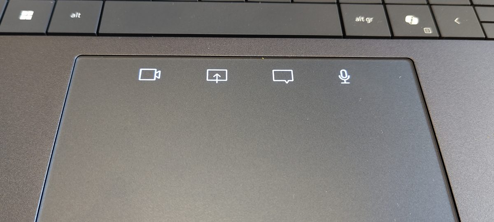
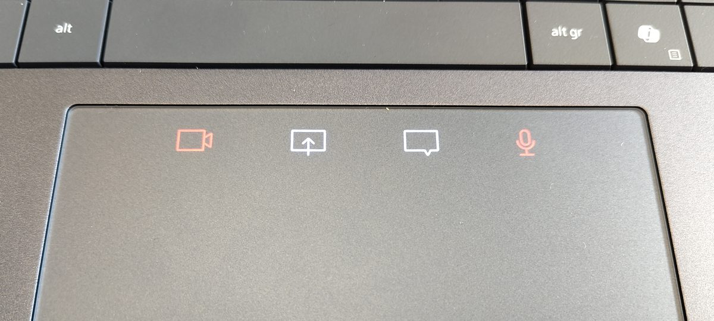

# Collaboration Touchpad icons on the Dell Pro 14 Premium under Ubuntu 26.04

| Camera on, microphone on | Camera off, microphone muted |
| --- | --- |
|  |  |

*The lit icon strip under Linux during a Zoom meeting: camera, share screen,
chat and microphone.*

The Dell Pro 14 Premium (PA14250) has a Collaboration Touchpad: a strip at the
top of the touchpad shows Zoom/Teams icons (mute, camera, share, chat). On
Windows, Dell Optimizer switches these icons on during a call. Under Linux the
icons stay dark by default, and taps on the strip arrive as ordinary touches.

Status as of 2026-11-19: working. A small user service lights the icons
during Zoom meetings and Teams meetings in Firefox, shows the camera and
microphone state, and handles taps (see [Meeting service](#meeting-service)). The rest of this page documents how the
protocol was found.

## Quick start

```sh
./install.sh     # run as your normal user; asks for sudo (packages, udev rules)
```

For Zoom, enable the global shortcuts in Zoom and your desktop, see
[Global shortcuts](#global-shortcuts). For Teams, restart Firefox once after
the install, see [Teams in Firefox](#teams-in-firefox). `./uninstall.sh` removes everything
again.

## Other laptops and distributions

Tested only on one Dell Pro 14 Premium (touchpad `0488:1083`) with Ubuntu
26.04, KDE Plasma 6 on Wayland, the Zoom `.deb` package and Teams in the
Firefox snap. Dell's Windows
agent is generic (it checks which features a touchpad offers), so other Dell
models with a Collaboration Touchpad probably use the same protocol, but this
is not confirmed. Reports from other setups are welcome, see
[Reporting back](#reporting-back).

### 1. Check the touchpad

This needs no root. It lists the HID device that has the icon interface
(vendor usage page `0xFF80` with report `0x16`); run it in bash or zsh:

```sh
for d in /sys/class/hidraw/*/device; do LC_ALL=C grep -qaF $'\x06\x80\xff\x09\x80\xa1\x01\x85\x16' $d/report_descriptor 2>/dev/null && echo "$d $(grep HID_NAME $d/uevent)"; done
```

- No output: the laptop has no Collaboration Touchpad, or one with a
  different interface. The service will not work.
- One line, for example `/sys/class/hidraw/hidraw1/device
  HID_NAME=VEN_0488:00 0488:1083`: the service finds the touchpad by this
  interface, not by its ID, so other touchpad models are picked up as well.

Before installing anything, test whether the icons light up for 10 seconds
(use the `hidrawN` from the line above):

```sh
sudo python3 collab_linux_test.py --dev /dev/hidrawN --plain --level 3 --seconds 10
```

### 2. Install

`install.sh` works on distributions with `apt-get` (Ubuntu, Debian), `dnf`
(Fedora) or `pacman` (Arch). It:

1. finds the touchpad and writes a udev rule for exactly that device,
2. installs the packages below,
3. adds a udev rule for `/dev/uinput` if the logged-in user cannot write to
   it yet (Ubuntu already allows it; the virtual keyboard needs it),
4. switches on the desktop accessibility flag (needed for Teams in Firefox),
   then installs and starts the systemd user service.

| Needed for | Ubuntu, Debian | Fedora | Arch |
| --- | --- | --- | --- |
| virtual keyboard | `python3-evdev` | `python3-evdev` | `python-evdev` |
| Zoom mute state, Teams buttons (AT-SPI) | `python3-gi`, `gir1.2-atspi-2.0` | `python3-gobject`, `at-spi2-core` | `python-gobject`, `at-spi2-core` |
| meeting detection (`pactl`) | `pulseaudio-utils` | `pulseaudio-utils` | `libpulse` |
| system mute fallback (`wpctl`) | `wireplumber` | `wireplumber` | `wireplumber` |

The Fedora and Arch package names are untested. On other distributions,
install the equivalent packages yourself and run
`SKIP_PACKAGES=1 ./install.sh`.

### 3. Desktop and meeting apps

| Setup | Expected result |
| --- | --- |
| KDE Plasma on Wayland | everything works with the two settings in [Global shortcuts](#global-shortcuts) |
| Any desktop on X11 | Zoom's global shortcuts work directly |
| GNOME on Wayland | icons and their states work; taps reach Zoom only while its window has focus (GNOME cannot pass keys to X11 apps in the background) |
| Zoom interface not in English | mic icon and tap fall back to the system mute |
| Zoom as Flatpak or Snap | untested; meeting, camera and mute detection may behave differently in the sandbox |
| Teams in Firefox | works on any desktop, taps included; needs the English Teams interface |
| Teams in another browser or the `teams-for-linux` app | not supported |

### Reporting back

Please open an issue in this repository with:

- the laptop model
- the output of the check in step 1
- the distribution and version, desktop and session type
  (`echo $XDG_SESSION_TYPE`)
- how Zoom or Firefox is installed (`.deb`, `.rpm`, Flatpak, Snap)
- what worked and what did not, with the log
  (`journalctl --user -u dell-collab-touchpad.service`)

## Hardware

| Component | Value |
| --- | --- |
| Touchpad | `VEN_0488:00 0488:1083`, I2C HID, driver `hid-multitouch` |
| Vendor collection | Usage page `0xFF80`, usage `0x80`, report ID `0x16` |
| BIOS setting | `CollaborationTouchpad` = `Enabled` (via `dell-wmi-sysman`) |

## Report 0x16 layout

Decoded from the HID report descriptor:

- Input (2 bytes): 8 button bits (usages `0x40` to `0x47`), one status byte
  (usage `0x48`).
- Output (5 bytes): six 3-bit fields with values 0 to 4 (usages `0x20`,
  `0x21`, `0x22`, `0x24`, `0x26`, `0x27`), three flag bits (`0x30` to
  `0x32`), then two 4-bit fields (usages 1 to 4 and `0xA2`).
- Feature (12 bytes): three 16-bit durations in ms (`0x61`, `0xA0`, `0xA1`),
  four bytes (`0xA3`, `0xA4`, `0xA6`, `0xA7`), one 16-bit value (`0x62`).

## Findings so far

- Default feature report on Linux: `16 58 02 e8 03 e8 03 10 ff 13 26 00 00`
  (600 ms, 1000 ms, 1000 ms, 16, 255, 19, 38, 0).
- Output reports with flag `0x30` set are answered with input report
  `16 00 40` or `16 00 60`; the other two flags get no answer.
- No combination of icon states and flags lit the icons, also when the
  report was resent every 250 ms.
- The very first blind probe got `16 00 40` (SwipeOff clear). Every run since
  then got `16 00 60` (SwipeOff set). The later steps of that first probe
  (selector bits, `0xA2` nibble and all three flags at once) probably set it.

## Windows: reading the state

[`collab_win_dump.py`](collab_win_dump.py) reads report `0x16` on a Windows
laptop with the same touchpad while Dell Optimizer has the icons lit. It only
reads; it does not write to the device.

```sh
pip install hidapi
python collab_win_dump.py   # during a Zoom desktop call, tap each icon once
```

If the feature report differs from the Linux default above, writing that value
under Linux may switch the icons on.

### Result: the script cannot read while Dell Optimizer runs

On 2026-11-19 the script printed `No vendor collection 0xFF80/0x80 found`.
The collection is there: Device Manager lists `HID\VEN_0488&Col06` with
hardware ID `HID\VID_0488&UP:FF80_U:0080`. But `CreateFile` on it fails with
error 32 (sharing violation), even with zero access rights, so hidapi skips it.
Dell Optimizer holds it open exclusively, so nothing can sniff it in parallel.

### Result with Dell Optimizer stopped

Dell Optimizer is not a service of its own; the `DellTechHub` service starts
`DellOptimizer.exe`. After `Stop-Service DellTechHub` and killing
`DellOptimizer.exe`, the lock went away a few seconds later and the script ran
(the admin shell needs the full path to the per-user `python.exe`). During an
active Zoom call, with the icons lit just before:

- Feature `0x16`: `16 58 02 e8 03 e8 03 10 ff 13 26 00 00`, identical to the
  Linux default. The feature report does not switch the icons on; Dell
  Optimizer must do it with output reports.
- No input reports in 30 s.

### Protocol decoded from CTPAgent.dll

Disassembled with capstone (`UpdateLedCtrl`, `SendHeartbeat`,
`UpdateCTPState`, `HandleInputReport`). The byte layout below was then built
with Windows' own `HidP_SetUsageValue`/`HidP_SetUsages` on the device's
preparsed data, without sending anything to the touchpad.

Output report `0x16`, 6 bytes with the report ID:

| Bits (after ID) | Usage | Meaning |
| --- | --- | --- |
| 0-2 | `0x20` | camera LED, white (camera on) |
| 3-5 | `0x21` | camera LED, red (camera off) |
| 6-8 | `0x22` | share-screen LED |
| 9-11 | `0x24` | chat LED |
| 12-14 | `0x26` | mic LED, white (unmuted) |
| 15-17 | `0x27` | mic LED, red (muted) |
| 18 | `0x30` | REQUEST: touchpad answers with a status input report |
| 19 | `0x31` | HEARTBEAT |
| 20 | `0x32` | OVERRIDE: host controls the LEDs |
| byte 4 bits 0-3 | usages 1-4 | per-button selector: 1 camera, 2 share, 3 chat, 4 mic |
| byte 5 bits 0-3 | `0xA2` | chat breathing (Optimizer writes 8, `0xF` or 0) |

- Button IDs inside the agent: 0 camera, 1 mic, 2 chat, 3 share screen.
- Each LED field gets Optimizer's brightness setting (0 to 4). Camera and mic
  have two LEDs; the state picks which one gets the value, the other gets 0.
- The selector bit is set for a button when it is enabled.
- `0x32` OVERRIDE is set together with the LED values, but only while the
  host has the strip temporarily disabled (see Q2 below).
- Status input `16 00 xx`: bit 7 TouchpadDisable, bit 6 TouchpadEnable,
  bit 5 SwipeOff (log string: `CTP FW state: ...`). So `16 00 40` and
  `16 00 60` on Linux were status reports.
- The heartbeat is not on a timer. `SendHeartbeat` runs only from
  `HandleInputReport`: when a status report arrives and TemporaryDisable is set,
  the host answers with a report that has only bit `0x31` set.

Single-field examples, as built by `HidP_*`:

```text
REQUEST            16 00 00 04 00 00
HEARTBEAT          16 00 00 08 00 00
OVERRIDE           16 00 00 10 00 00
all on, level 4,   16 20 09 12 0f 00   (0x21, 0x22, 0x24, 0x27 = 4, camera+mic red,
selectors+override                      selectors 1-4, override)
```

### Other strings in CTPAgent.dll

The native agent
`C:\Program Files\Dell\DellOptimizer\Plugins\Bootstrap\CollaborationTouchpadPlugin.CTPAgent.dll`
talks to the collection through `HidD_SetFeature`, `HidP_SetUsages`,
`HidP_SetUsageValue` and `WriteFile`. Log strings not yet mapped to code:

- `Activate HID`, `Enable HID`, `EnableFeature`, `SetButtonLight for BUTTON_ID`,
  `UpdateLedCtrl`, `EnableChatBreathing`.
- Output report handlers for `SYNC`, `GESTURE`, `enabled`, `disabled` and for
  the mic, camera, share-screen and chat buttons.
- Feature usages `USAGE_DBLTAP_DURATION_MAX` and `USAGE_INTENSITY`.

The managed wrapper `Dell.Optimizer.Plugin.CollaborationTouchpad.dll` only
calls into this native DLL.

## Linux: replaying the protocol

[`collab_linux_test.py`](collab_linux_test.py) replays the decoded protocol
over hidraw: REQUEST, then the LED report, then a heartbeat in reply to each
status report. Options:

| Option | Effect |
| --- | --- |
| `--hb-with-leds` | heartbeats (and timed REQUESTs) also carry LED, selector and OVERRIDE bits |
| `--hb-period N` | extra heartbeat every N s (default 0.5, 0 = only in reply to status) |
| `--req-period N` | REQUEST every N s, so status replies and heartbeats keep coming |
| `--no-selector`, `--no-override` | leave those bits out |
| `--no-heartbeat` | never send heartbeats (no reply, no timer) |
| `--plain` | Optimizer's normal path: `--no-override --no-heartbeat` |
| `--level N`, `--seconds N` | LED value 0 to 4, run time |

[`collab_status.py`](collab_status.py) sends one REQUEST and prints the
status reply, without touching the LEDs.

### Results on 2026-11-19

| Command | Result |
| --- | --- |
| `collab_linux_test.py` | one status reply, then silence; icons dark |
| `--hb-with-leds --hb-period 0` | one status reply, one heartbeat, then silence; icons dark |
| `--hb-with-leds --hb-period 0 --req-period 0.5` | stable loop for 30 s (REQUEST, status, heartbeat); icons dark |

Every status reply was `16 00 60`: TouchpadEnable and SwipeOff set. The
touchpad accepts and answers the protocol, so the keepalive is not what is
missing. Two candidates remain:

1. **SwipeOff.** If it means "collaboration strip switched off", the firmware
   may ignore LED requests while it is set. It may have been set by the first
   blind probe (see Findings). Test: power off fully, boot, run
   `sudo python3 collab_status.py` before anything else. If it shows
   `swipeoff=0`, run the replay with `--hb-with-leds --hb-period 0
   --req-period 0.5` at once.
2. **Init writes.** `Activate HID`, `Enable HID` and `EnableFeature` suggest a
   setup sequence (probably via `HidD_SetFeature`) before the first LED report.
   The feature report read after Optimizer was stopped equals the Linux
   default, so the write may be transient or use another report.

## Answers from the Windows laptop (2026-11-19, from CTPAgent.dll)

### Q1: init writes

There are none. Apart from logging, the agent writes to the collection in
exactly one place, `WriteOutputReportInternal`, which uses `WriteFile` with
output report `0x16`. `HidD_SetFeature` is only used by `SetClickMode` (the
double-tap durations in feature `0x16`) and by the haptic touchpad code.
`Activate` and `Enable` only change internal state and then call `Update`,
which builds the LED report. At startup the agent checks whether the output
report has usage `0x32` (stored at offset `0x448`, "override supported") and
`0x31` (offset `0x449`, "heartbeat supported"). Both are present on this
touchpad.

### Q2: SwipeOff and the OVERRIDE/HEARTBEAT path

The agent keeps two flags. The log string
`Can't update CTP state because TemporaryDisable (%d) or TabletModeDisable (%d)`
names them:

- `TabletModeDisable` = status bit 7 (TouchpadDisable).
- `TemporaryDisable` = status bit 5 (SwipeOff), but only on touchpads
  without OVERRIDE support. On this touchpad SwipeOff is logged and then
  ignored. `TemporaryDisable` is set only by the host (`Activate` with
  state 4).

The LED update (`Update`) is skipped while either flag is set. The two
special bits are used only in the `TemporaryDisable` case:

- `UpdateLedCtrl` sets `0x32` OVERRIDE only when override is supported and
  `TemporaryDisable` is set.
- `SendHeartbeat` (`0x31`) runs only when a status report arrives and
  `TemporaryDisable` is set.

In normal use, with the icons lit during a call, Optimizer therefore sends
**plain LED reports: LED values plus selector bits, no OVERRIDE, no
heartbeat**. OVERRIDE plus heartbeats seems to mean "host forces the strip
off". This would explain the dark icons in every Linux run so far: all of them
set OVERRIDE, and most sent heartbeats.

Note that the input path only reacts to status reports with no button bits
set. Button taps are handled separately (button IDs 0 camera, 1 mic, 2 chat,
3 share).

### Dell Optimizer settings page

The page "Touchpad für die Zusammenarbeit" maps onto the protocol:

| Setting | Protocol |
| --- | --- |
| Toggles Video, Freigeben, Chat, Mikrofon (all on) | selector bits in byte 4 (`0f`) |
| Helligkeit der Symbole (slider at about 2/3) | LED field value, probably 3 of 1-4 |
| Automatic brightness (on) | managed plugin reads the ambient light sensor and changes the level |
| Blinken des Chat-Symbols (on) | `0xA2` chat breathing, byte 5 |
| Symbole nur beim Doppeltippen aktivieren (off) | `SetClickMode`, the only feature-report write (double-tap durations) |

## Working: icons lit on Linux

On 2026-11-19 the icons lit up for the first time with:

```sh
sudo python3 collab_linux_test.py --plain --level 3 --seconds 60
```

This sends one REQUEST and then one plain LED report, `16 d8 86 01 0f 00`
(level 3 on usages `0x21`, `0x22`, `0x24`, `0x27`, selectors 1 to 4, no
OVERRIDE, no heartbeat). Observations:

- The icons stay lit for the whole run without any heartbeat, and go dark when
  the script sends the all-zero report at the end.
- Status was `16 00 60` (SwipeOff set) and the icons still lit, which confirms
  that this touchpad ignores SwipeOff.
- Camera and mic lit **red**, share and chat **white**. On Windows, red is
  what the icons show with camera and mic off: `0x21` and `0x27` are the
  red "off/muted" LEDs. Writing `16 c3 36 00 0f 00` (level 3 on `0x20`,
  `0x22`, `0x24`, `0x26`) lit all four icons white, so `0x20` and `0x26` are
  the white "on" LEDs. The script lights white by default; `--red` selects
  the red pair.
- Tapping the lit icons (camera, share, chat, mic, in this order) did not
  visibly move or click the cursor.

### Button taps

While the icons are lit, each tap sends one input report `16 xx 40`:

| Icon | Report | Button bit (usage) | Touch X (of 2952) |
| --- | --- | --- | --- |
| Camera | `16 02 40` | bit 1 (`0x41`) | about 596 |
| Share | `16 04 40` | bit 2 (`0x42`) | about 1212 |
| Chat | `16 08 40` | bit 3 (`0x43`) | about 1831 |
| Mic | `16 10 40` | bit 4 (`0x44`) | about 2441 |

The finger reports of the tap still arrive, but the touchpad ends the touch
with `01 02 ...` (tip set, confidence cleared, coordinates 0) instead of the
normal lift `01 01 ...`. Linux treats a touch without confidence as a palm and
drops it, which is why taps on lit icons do not move or click the cursor.

`--req-period` sends a bare REQUEST unless `--hb-with-leds` is also given. If
each report replaces the full LED state, a bare REQUEST switches the icons
off, so combine the two: `--plain --hb-with-leds --req-period 0.5`.

## Meeting service

[`collab_touchpad.py`](collab_touchpad.py) runs as the systemd user service
`dell-collab-touchpad.service`. Once per second it checks whether a Zoom or
Teams meeting runs, reads its state and rewrites the LED report when it
changes (and every 10 s, in case the touchpad was reset by a suspend). If both
run at once, Zoom wins.

### Zoom

| Icon | Lit | Tap |
| --- | --- | --- |
| Camera | white while Zoom holds a `/dev/video*` open, else red | Alt+V to Zoom (start/stop video) |
| Share | white | Alt+S to Zoom (share screen) |
| Chat | white | Alt+H to Zoom (show/hide chat) |
| Mic | red while Zoom shows you muted, else white | Alt+A to Zoom (mute/unmute) |

- **Meeting detection:** the icons are lit while Zoom has a recording stream
  named `ZOOM VoiceEngine` open (`pactl list source-outputs`), which it does
  only while connected to meeting audio. The helper process `aomhost` is not a
  usable signal: it keeps running after the first meeting until Zoom quits.
- **Camera state:** Zoom opens the video device only while the camera is on,
  so `/proc/<zoom pid>/fd` gives the true state for any camera.
- **Microphone:** Zoom keeps its recording stream open and unchanged when
  muted, so the audio system does not show Zoom's mute state. Zoom does
  expose its window contents over AT-SPI (the accessibility interface screen
  readers use): the toolbar button in the "Meeting" window reads "Mute" while
  you are audible and "Unmute" while you are muted. The service reads that
  text every second (about 0.1 s per read). It depends on Zoom's English
  interface; if the button is not found, the mic icon shows the system mute
  (`wpctl`) instead, and a tap toggles the system mute.

### Teams in Firefox

| Icon | Lit | Tap |
| --- | --- | --- |
| Camera | white while the camera button reads "Turn camera off", else red | presses the camera button |
| Share | white | presses "Share" (the screen picker still needs a click) |
| Chat | white | presses "Chat" in the meeting controls |
| Mic | red while the mute button reads "Unmute mic", else white | presses the mute button |

- **Meeting detection:** the icons are lit while Firefox has a recording
  stream whose name, the tab title, contains "Microsoft Teams". Teams keeps
  this stream open while muted and closes it when you leave.
- **State and taps:** Teams' meeting toolbar buttons are read and pressed over
  AT-SPI, also while the Teams tab is in the background or Firefox is
  minimized. No keyboard shortcuts are involved, so this works on any desktop.
  A scan takes about 0.03 s with the tab in front and 0.2 s in the background.
  It depends on Teams' English interface; without the mute button, the mic
  icon shows the system mute and a tap toggles it.
- **Accessibility flag:** Firefox exposes web pages over AT-SPI only while the
  desktop accessibility flag is on (`org.a11y.Status IsEnabled`, stored in
  `org.gnome.desktop.interface toolkit-accessibility`). `install.sh` switches
  it on; Firefox must be restarted once afterwards. The flag stays on after
  `uninstall.sh`, since other tools may rely on it. To switch it off:
  `gsettings set org.gnome.desktop.interface toolkit-accessibility false`.
- **Desktop app:** the `teams-for-linux` snap failed here: its sandbox denies
  the microphone (`audio-record` not connected) and its D-Bus control
  interface. The `.deb` version registers that interface and reports call and
  mute state, but its mute and video commands had no effect, and camera and
  screen sharing failed (the cause was not investigated further). Teams in
  Firefox had none of these problems.

### Common to both

- **Access:** the udev rule
  [`70-dell-collab-touchpad.rules`](config/70-dell-collab-touchpad.rules)
  gives the logged-in user access to the touchpad's hidraw node
  (`install.sh` fills in the ID of the detected touchpad). This node also
  carries the raw finger reports of the touchpad. Key presses go through a
  virtual keyboard on `/dev/uinput`, which the logged-in user can already use
  on Ubuntu; elsewhere `install.sh` adds a rule for it.
- **Brightness:** level 3 of 4; set `COLLAB_LEVEL` in the unit to change it.

### Global shortcuts

Only needed for Zoom. Zoom only reacts to Alt+V, Alt+S, Alt+H and Alt+A
while its window has focus, unless the shortcuts are global. Zoom runs as an
X11 app under XWayland, so two settings are needed:

1. Zoom: Settings, Keyboard Shortcuts: tick "Enable Global Shortcut" for
   "Mute/Unmute My Audio", "Start/Stop Video", "Start/Stop Screen Sharing"
   and "Show/Hide In-Meeting Chat Panel".
2. KDE: System Settings, Legacy X11 App Support: allow X11 apps to read
   keystrokes "As above, plus any key typed while the Control, Alt, or Meta
   keys are pressed".

### Logs

```sh
systemctl --user status dell-collab-touchpad.service
journalctl --user -u dell-collab-touchpad.service
```

## Still open on the Windows side

1. While Optimizer has the icons lit, what is the status byte? Either decode
   it from the agent's log (`CTP FW state: ...`, if logging can be enabled) or
   hook `ReadFile`/`WriteFile` in `DellOptimizer.exe` (API Monitor or Frida, as
   administrator) and log all report `0x16` traffic during a Zoom call.
2. After stopping `DellTechHub` and `DellOptimizer.exe`: do the icons go dark
   at once, after a delay, or not at all? Does swiping across the strip change
   them?

Feed the answers back into this file; the Linux side can then replay the
exact sequence with `collab_linux_test.py`.
